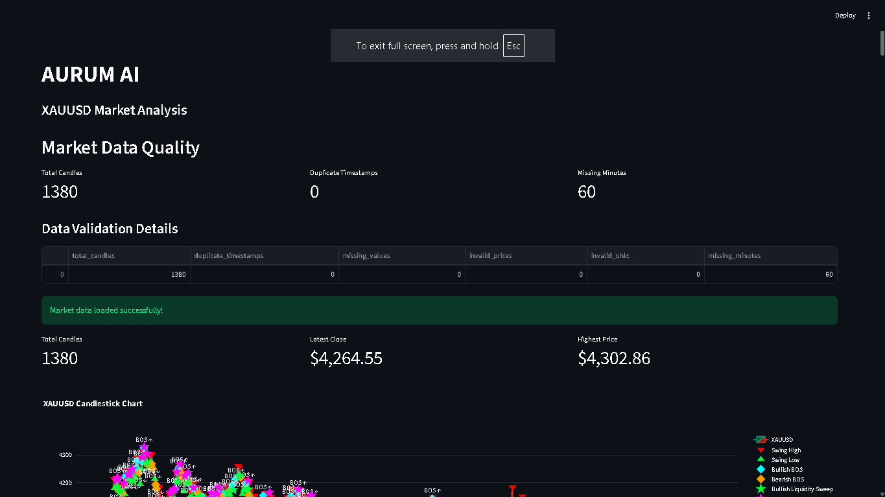

# AURUM AI

**AI-Powered XAUUSD Market Analysis and Machine Learning Research Platform**

AURUM AI is a Python-based research project designed to analyze historical Gold (XAUUSD) market data using technical analysis, market structure, backtesting, risk management, and machine learning.

## Dashboard Preview



## Features

- Historical XAUUSD market data analysis
- Market structure detection
- Break of Structure (BOS) detection
- Liquidity sweep detection
- Basic backtesting
- Advanced backtesting with stop-loss and take-profit
- Risk management simulation
- Performance and drawdown analysis
- Machine learning feature engineering
- Logistic Regression model
- Random Forest model
- Machine learning model comparison
- Interactive Streamlit dashboard
- Market data quality validation

## Technologies Used

- Python
- Pandas
- NumPy
- Streamlit
- Plotly
- Scikit-learn
- Matplotlib
- Pytest

## Project Structure

```text
AURUM-AI/
│
├── App.py
├── README.md
├── requirements.txt
├── .gitignore
├── dashboard.png
│
├── data/
│   ├── sample_xauusd.csv
│   └── xauusd_1m.csv
│
├── src/
│   ├── data_loader.py
│   ├── market_structure.py
│   ├── bos_detector.py
│   ├── liquidity_sweep.py
│   ├── backtester.py
│   ├── advanced_backtester.py
│   ├── risk_simulator.py
│   ├── risk_manager.py
│   ├── performance.py
│   ├── data_quality.py
│   ├── ml_features.py
│   └── ml_model.py
│
└── tests/
```

## Installation

Clone the repository:

```bash
git clone https://github.com/alokg8101-eng/AURUM-AI.git
cd AURUM-AI
```

Install the dependencies:

```bash
pip install -r requirements.txt
```

## Run the Dashboard

```bash
python -m streamlit run App.py
```

The dashboard will open in your browser.

## Run Tests

```bash
python -m pytest -v
```

## Machine Learning

AURUM AI experiments with two classification algorithms:

1. Logistic Regression
2. Random Forest Classifier

The models analyze historical candle-based features and attempt to classify the next candle's price direction.

Model performance is evaluated using accuracy and balanced accuracy.

## Project Status

**Status:** Under Development

This project is being developed as a learning and research project in Python, quantitative analysis, and machine learning.

## Disclaimer

AURUM AI is an educational and historical market research project. Backtesting and machine learning results do not guarantee future performance or profitability. This project does not execute live trades or real-money transactions.